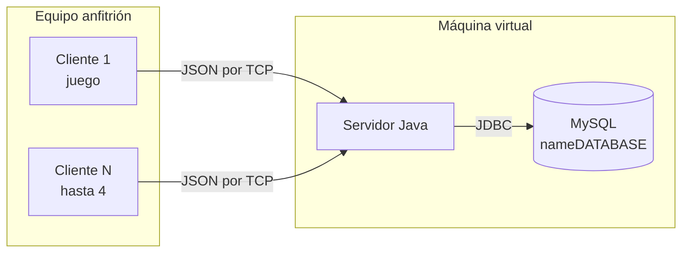

# PCN Multijugador

Juego 2D multijugador en **Java** (Swing) para hasta **4 jugadores**. Cada jugador se
autentica con usuario y contraseña guardados en **MySQL**, mueve su personaje con
**W A S D** y ve a los demás en tiempo real. El servidor valida el acceso, asigna un
lugar y distribuye las coordenadas; no dibuja ni simula el juego.

Proyecto de **Cómputo en la Nube** (UASLP, Facultad de Ingeniería). Empezó como un chat
multiusuario (parcial 1) y evolucionó a este juego (parcial 2). La documentación de esas
entregas está en [`docs/historial/`](docs/historial/).

## Arquitectura



- El cliente nunca habla con MySQL: envía sus credenciales al servidor y este consulta la base.
- Se intercambian mensajes JSON, uno por línea. Detalle en [`docs/PROTOCOLO.md`](docs/PROTOCOLO.md).
- El color del jugador depende del lugar que recibe al conectarse (rojo, azul, verde, amarillo), no del usuario.

## Estructura del repositorio

```
.
├── servidor/               Proyecto Maven (NetBeans), corre en la VM
│   ├── pom.xml
│   ├── config.example.properties   → copiar como config.properties
│   └── src/main/java/com/mycompany/chatmultiusuario/
├── cliente/                Juego Swing, se ejecuta sin Maven en el host
│   ├── src/                main, entidad, tile, red + sprites y tiles
│   ├── lib/gson-2.14.0.jar
│   ├── cliente.properties          usuario y contraseña del jugador
│   ├── config/Jugador1..4.properties
│   ├── servidor.properties.example → copiar como servidor.properties
│   └── ejecutar.sh / ejecutar.bat
├── database/usuarios.sql   Crea la tabla y las 4 cuentas de prueba
├── docs/                   Instalación, protocolo e historial de entregas
├── CONTRIBUTING.md         Cómo trabajar en equipo
└── .github/                Plantillas de Pull Request e Issues
```

## Requisitos

- **JDK 17 o superior** (`java -version` y `javac -version`).
- **MySQL** en la VM (o accesible desde ella).
- **Servidor:** NetBeans o Maven (descarga las dependencias en la primera compilación).
- **Cliente:** solo el JDK; Gson ya viene en `cliente/lib/`.
- Una VM con red en **modo puente** que permita TCP 5555.

## Inicio rápido

**1. Base de datos** (en la VM). Ojo: el script borra la tabla `usuarios` y la recrea.

```bash
mysql -u root -p < database/usuarios.sql
```

**2. Servidor** (en la VM)

```bash
cd servidor
cp config.example.properties config.properties   # escribe tu usuario y contraseña de MySQL
mvn compile exec:java                             # o ejecuta el proyecto desde NetBeans
```

Debe mostrar `Conexion a MySQL correcta.` y `Servidor PCN en puerto 5555. Maximo 4 jugadores.`

**3. Cliente** (en el host, una terminal por jugador)

```bash
cd cliente
cp servidor.properties.example servidor.properties   # escribe la IP de la VM
bash ejecutar.sh config/Jugador1.properties          # Windows: ejecutar.bat config\Jugador1.properties
```

Repite con `Jugador2`, `Jugador3` y `Jugador4` para tener más jugadores.
Guía completa y solución de problemas: [`docs/INSTALACION.md`](docs/INSTALACION.md).

## Cuentas de prueba

| Usuario | Contraseña |
|---------|------------|
| Jugador1 | Player1 |
| Jugador2 | Player2 |
| Jugador3 | Player3 |
| Jugador4 | Player4 |

Solo para desarrollo. Cada usuario puede tener una sola sesión a la vez.

## Configuración local (no se sube a git)

| Archivo | Contiene | Plantilla |
|---------|----------|-----------|
| `servidor/config.properties` | Datos de MySQL | `config.example.properties` |
| `cliente/servidor.properties` | IP de la VM | `servidor.properties.example` |

Cada integrante crea los suyos, así nadie pisa la configuración de otro.

## Documentación

- [Instalación y ejecución](docs/INSTALACION.md)
- [Protocolo cliente-servidor](docs/PROTOCOLO.md)
- [Cómo contribuir](CONTRIBUTING.md)
- [Historial de entregas (parcial 1 y 2)](docs/historial/)

## Limitaciones conocidas

- Las contraseñas están en texto plano en la base de datos y los sockets no usan TLS.
- El servidor confía en el movimiento que calcula el cliente; solo valida los límites de la ventana.
- Sin colisiones, sin mapa externo (solo fondo de pasto), sin reconexión automática ni persistencia de posiciones.
- No hay chat de texto en esta versión.

Son buenos candidatos para las siguientes entregas: abre un Issue por cada uno.
